# What's Next for Claude Code

[Install](#install-and-update) · [What's Next](#whats-next) · [In pictures](#in-pictures) · [What it needs](#what-it-needs) · [Settings](#settings) · [Bugs and ideas](#bugs-and-ideas)

Your next issue, in a docked pane beside the conversation. From Forgejo,
GitLab or GitHub.

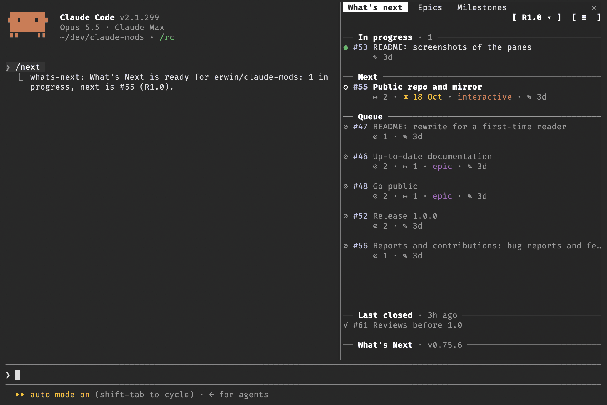

- Next: the first available issue: due soon first, then ordered by where
  you work and how many issues wait on it.
- Every open issue by milestone, epics folded open on their children, and
  milestones with their progress; narrowed by milestone and by label.
- Assign yourself, close an issue, change its labels, milestone or epic, or
  put it into your prompt, without leaving Claude Code.

What's Next is a mod: a change to Claude Code's own interface. It needs an
up to date version of Claude Code, in the terminal. Its panes do not load on
claude.ai or in Cowork, and in a Code session of the Claude desktop app it
stops at setup (see [Settings](#settings)).

## Install and update

Install, in Claude Code (answer `y` to add the marketplace, then pick a
scope):

```
/plugin install whats-next --marketplace egribnau/whats-next
```

Update, from a shell, then run `/reload-plugins` in an open session:

```
claude plugin marketplace update egribnau
claude plugin update whats-next@egribnau
```

## What's Next

`/next` opens docked panes on the issues of the repo behind the current
directory's `origin`:

- **What's next**: your issues In progress, Next and the Queue after it.
  Next is the first available issue: assigned to no one, not blocked. An
  issue due within 7 days or past due comes first, by its own due date, its
  epic's or its milestone's. After those, Next follows on from where you
  work: the epic or milestone of your issue in progress, or of the issue
  you closed last.
- **Issues**: the open issues of a milestone, its epics first, each
  unfolding to its children.
- **Milestones**: every open milestone, with its epics and issues.
- **Milestone filter** (`m`): narrows What's next and Issues to one milestone.
- **Label filter** (`l`): narrows What's next and Issues to the issues with
  every label ticked (and), with one of them (or), or without a label
  (No label); with or, No label ticks along with the labels. A second press
  on a label's box leaves it out (☒): `docs, not bug`.
  Its button names what is set, All when nothing is. Tick `epic` for the
  epics alone.
- **Issue detail**: epic, children, blockers, due date, milestone, labels,
  pull requests, commits, description and comments. Assign yourself, close,
  reopen, add or take off a label, move it to another milestone (its
  children too), put it under an epic or take it out of one, open in the
  browser, or put the issue into your prompt.
- **Help** (`h`): what each sign and colour means.

| Command | Opens |
| --- | --- |
| `/next` | the panes, with What's next in front and the keyboard on it |
| `/next help` | What's next on the help page |

- Esc returns to the prompt.
- When another plugin already has `/next`, the command is `/whats-next` in
  that session, and a toast says so.

### In pictures

| Issues | Milestones |
| --- | --- |
| 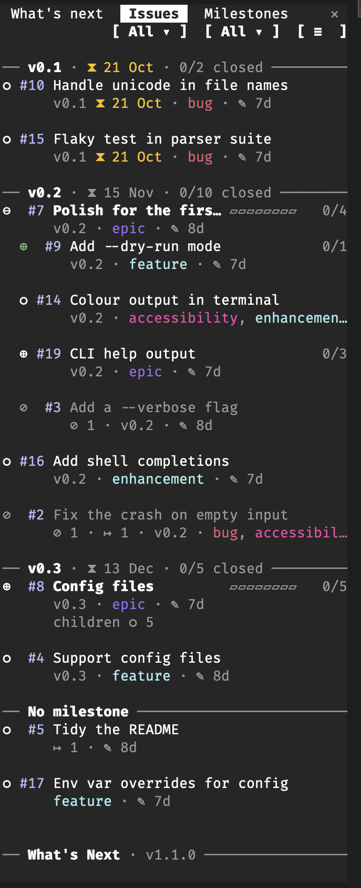 | 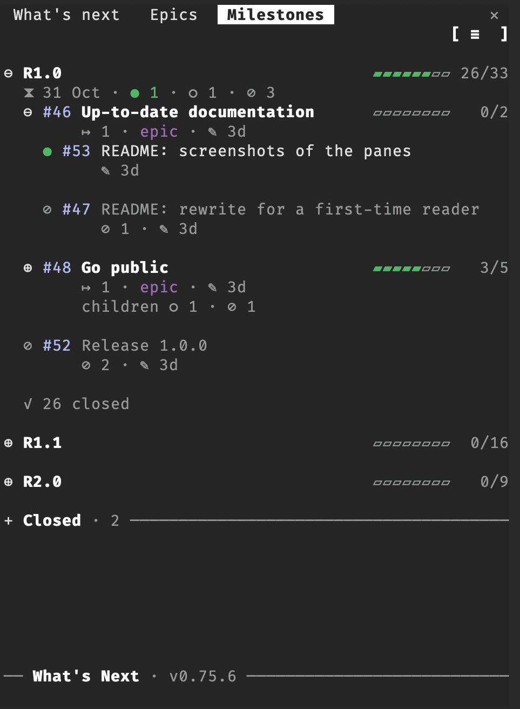 |
| **An issue** | **Its menu** |
| 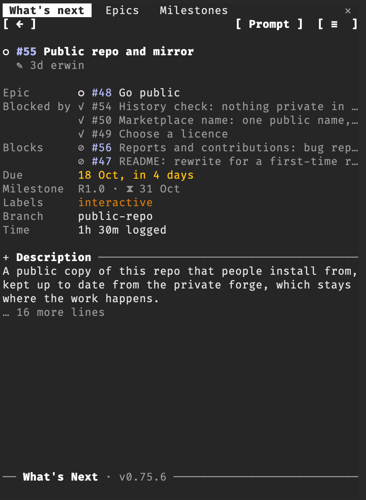 | 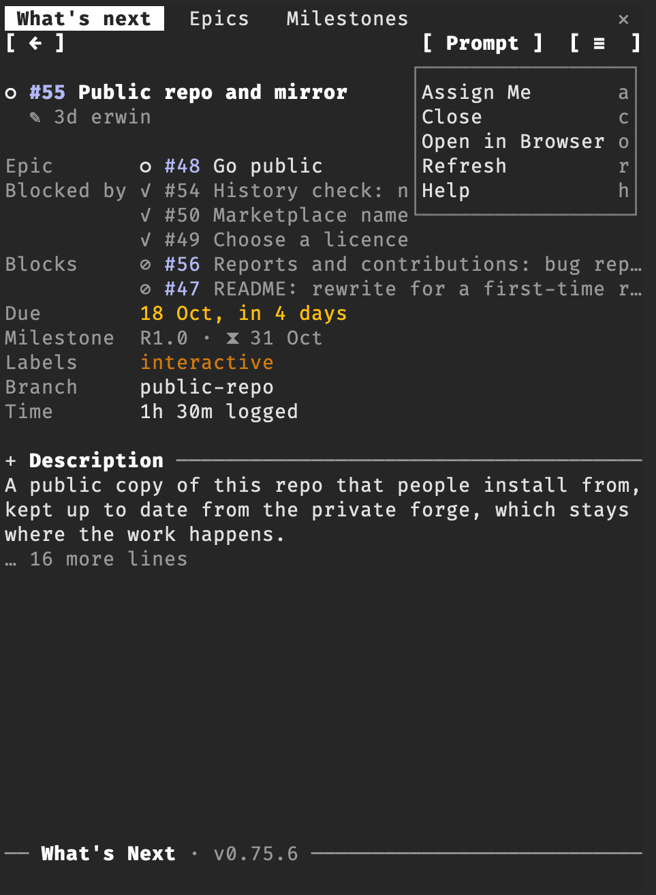 |
| **Its labels** | **The label filter** |
| 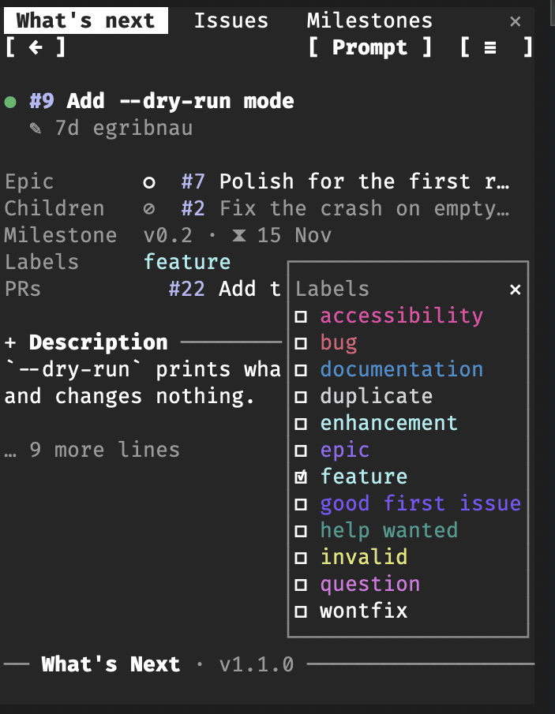 | 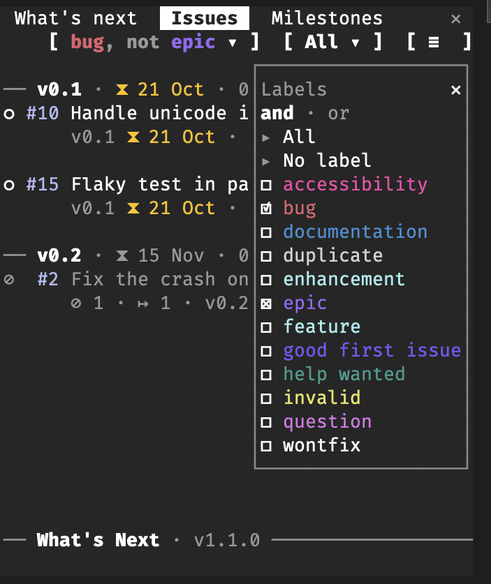 |
| **A milestone** | **Help** |
| 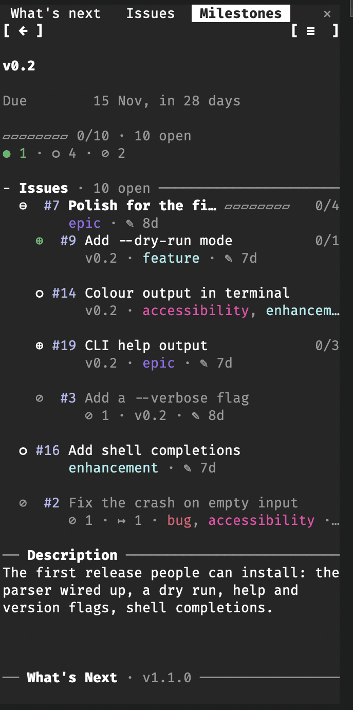 | 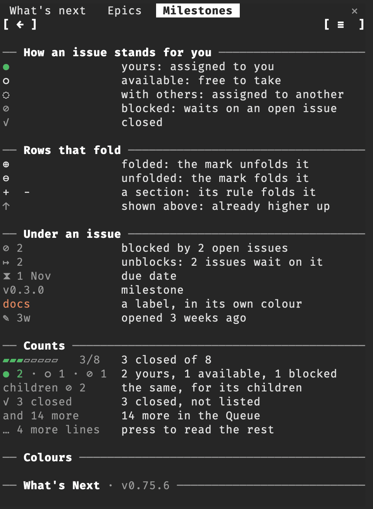 |
| **Setup, stopped at the token** | |
| 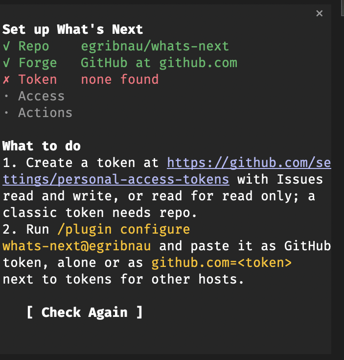 | |
| **Compact off** | **Compact on** |
| 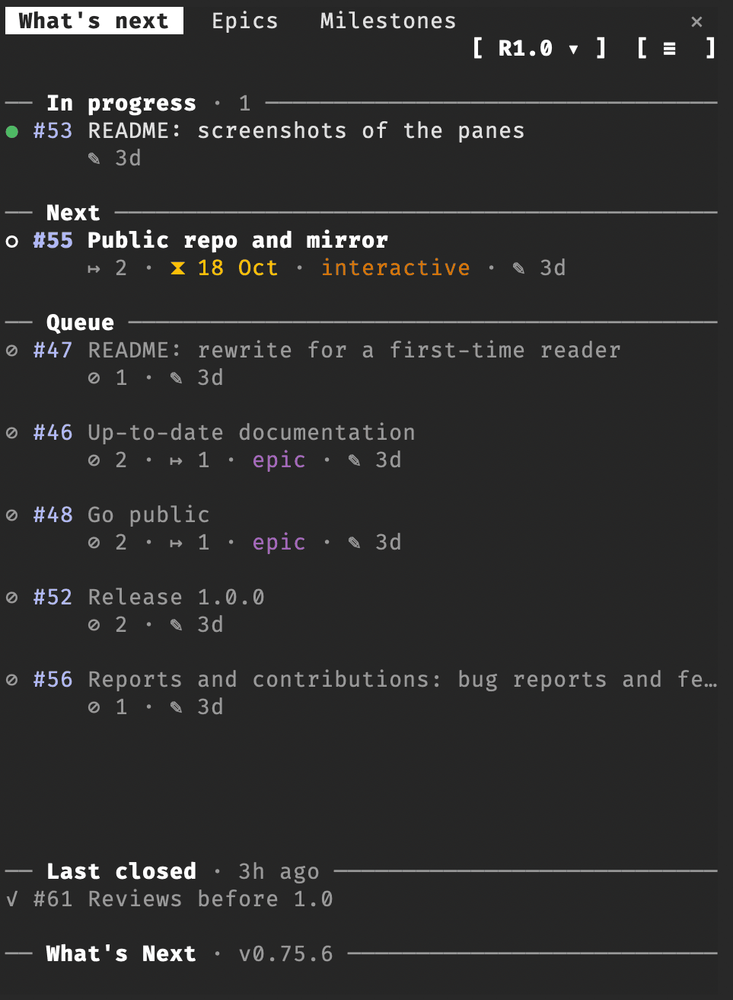 | 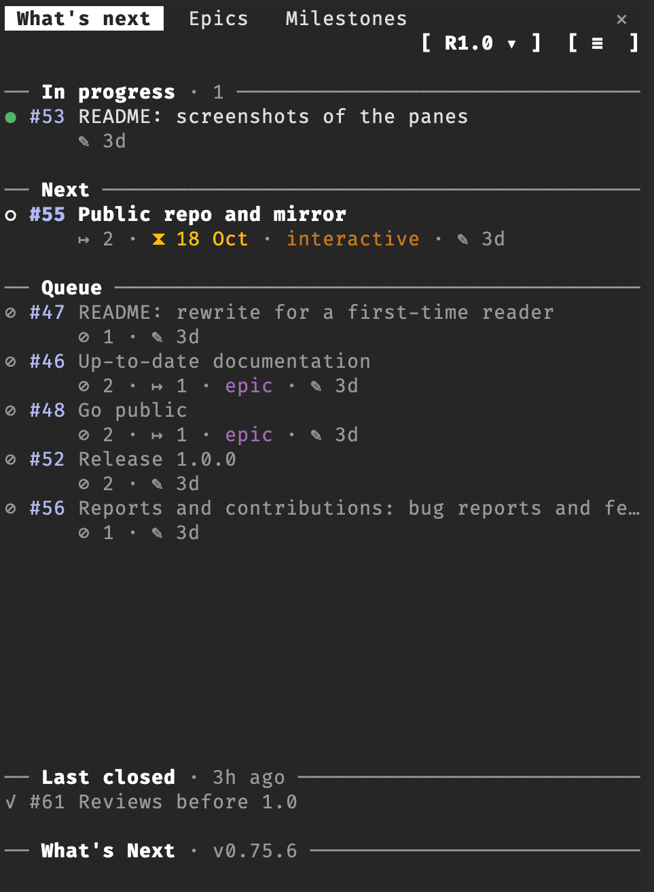 |

### What it needs

A repo on one of these forges, and an access token for it:

| Forge | Token setting | To read | To assign, close and change labels, milestones and epics |
| --- | --- | --- | --- |
| Forgejo or Gitea | Forgejo tokens | `read:issue`, `read:repository`, `read:user` | `write:issue` in place of `read:issue`, and push rights on the repo |
| gitlab.com | GitLab.com token | `read_api` | `api`, and Reporter or higher on the project |
| GitLab on your own host | Private GitLab token | `read_api` | `api`, and Reporter or higher on the project |
| github.com or GitHub Enterprise | GitHub token | fine-grained: Issues read; classic: `repo` (`public_repo` on a public repo) | fine-grained: Issues read and write; classic: `repo`; and push rights on the repo |

Tested on Forgejo, GitLab Free and GitHub. Blockers come from Forgejo's
dependencies, GitHub's "blocked by" relations and GitLab's blocking links;
GitLab has blocking links only in EE, where What's Next reads them but they
are not tested here. On GitLab Free nothing shows as blocked.

Until all is set, the pane walks you through setup: the repo, the forge at
its host, the token, whether it reads the repo, and whether What's Next may
assign, close and change labels, milestones and epics or is read only.

A token goes only to the host it is for, and What's Next shows it nowhere.
It reads tokens only from its own settings: no environment variables, no
files of other tools.

### Settings

Set the tokens with `/plugin configure whats-next@egribnau`; the other
settings are also in `/config`, under What's Next.

| Setting | Default | What it does |
| --- | --- | --- |
| Forgejo tokens | empty | Forgejo or Gitea tokens. A bare token is for every host; more hosts take `host=token` pairs separated by spaces (`git.example.org=<token> codeberg.org=<token>`), and a pair wins over a bare token. |
| GitLab.com token | empty | The token for gitlab.com. |
| Private GitLab token | empty | The token for your own GitLab, any host but gitlab.com; `host=token` pairs for more than one host. |
| GitHub token | empty | The token for github.com and GitHub Enterprise; `host=token` pairs for more than one host. |
| Epic label | `epic` | The label that makes an issue an epic. |
| Compact | `ask` | `on`: lists without an empty line between rows. `ask`: What's Next asks once. |
| Icons | `ask` | `icons`: buttons as Nerd Font icons; `text`: as words. `ask`: What's Next asks once, after setup. |
| Debug | off | A line under the bottom line counts the requests to the forge, for the last action and the session. |

Tokens are kept in secure storage. In a Code session of the Claude desktop
app they stay empty, so the pane stops at setup's Token step: What's Next is
for the terminal.

How the panes draw and order issues is in [docs](docs).

## Bugs and ideas

Report a bug or ask for a feature in an issue on
[GitHub](https://github.com/egribnau/whats-next/issues/new/choose), with
the bug report or feature request template.

What's Next takes no code from others: no pull requests, patches or code in
issues. Code from someone else would have to be checked for anything
malicious, and that is not done here. Pull requests are closed unread.

## Working on What's Next

Add your clone as a marketplace and install from it; Claude Code then reads
the folder itself, and `/reload-plugins` picks up an edit without a push:

```
claude plugin marketplace add <path to your clone>
claude plugin install whats-next@egribnau
```

Checks and tests are listed in [.claude/CLAUDE.md](.claude/CLAUDE.md).

## Licence

Copyright (C) 2026 Erwin Gribnau.

What's Next is free software under the GNU Affero General Public License,
version 3 only (`AGPL-3.0-only`): see [LICENSE](LICENSE). It comes with no
warranty.

## What it sends where

What's Next talks only to the host in the repo's `origin`, over HTTPS. It
sends nothing anywhere else: no other hosts, no usage data. Which host that is
comes from your repo, so the code names no fixed address.

| What | To | With |
| --- | --- | --- |
| Which forge the host runs: `/api/v1/version`, `/api/v4/version` and `/api/v3/meta` in turn, until one answers. Not asked for github.com and gitlab.com. | the repo's host | no token |
| The repo, your account, and its issues, milestones, labels, epics and blockers; what you change: assignee, closed, labels, milestone, epic | Forgejo `https://<host>/api/v1`, GitLab `https://<host>/api/v4`, github.com `https://api.github.com`, GitHub Enterprise `https://<host>/api/v3` | the token setting for that forge and host: `Authorization` header, `PRIVATE-TOKEN` on GitLab |
| On Forgejo, your account's tokens, to read the scopes of the one in use (matched on its last eight characters) | `https://<host>/api/v1/users/<you>/tokens` | the Forgejo token |

A token goes only to the host it is for (see [What it needs](#what-it-needs)).
Tokens come only from the four token settings, kept in secure storage: no
environment variable and no file of another tool is read for one, and the
tests check this.

On your computer it runs these programs, each with the words shown and
nothing else:

- `git remote get-url origin` and `git rev-parse --is-inside-work-tree`, to
  find the repo;
- `pwd`, to name the folder in setup when it holds no repo;
- `open` on macOS, else `xdg-open`, with a page's `https` address, when you
  open an issue, a milestone or What's Next's own repo in the browser. An
  address the forge gives that is not `https://` is not opened: nothing else
  it fetches is ever run.

It reads one file, its own `.claude-plugin/plugin.json`, for the version on
its bottom line, and sends nothing of it anywhere. It reads no other file and
no environment variable.

In Claude Code it:

- reads your prompt only when you press Prompt on an issue, and only to see
  whether it already holds text: the issue goes under what you typed, or in
  alone. The issue goes to Claude only when you send the prompt. It reads
  nothing else of the conversation, and sends none of it to the forge;
- writes only its own settings Icons and Compact in `/config`, each only when
  you answer its question about it after setup: no other setting, no
  permission and no environment variable;
- adds the command `/next` (`/whats-next` when another has `/next`), and
  opens, draws and closes its panes.

Its hooks: `session.start` adds the command and, after a reload with the
panes open, loads again; `classic.SessionStart` loads again after `/clear`;
`command.run` runs `/next`; `config.set` passes every setting on unchanged
and only notes a change to Icons or Compact, so the panes follow it; the
`ui` hooks draw the panes and follow their scrolling, focus and closing.

The scripts in `docs/` are for working on What's Next: the mod never runs
them. `check-tokens.sh` and `check-marketplace.sh` only read the mod's files to
check them, and change none; `shoot.py` takes the screenshots in `images/` for
this README.
